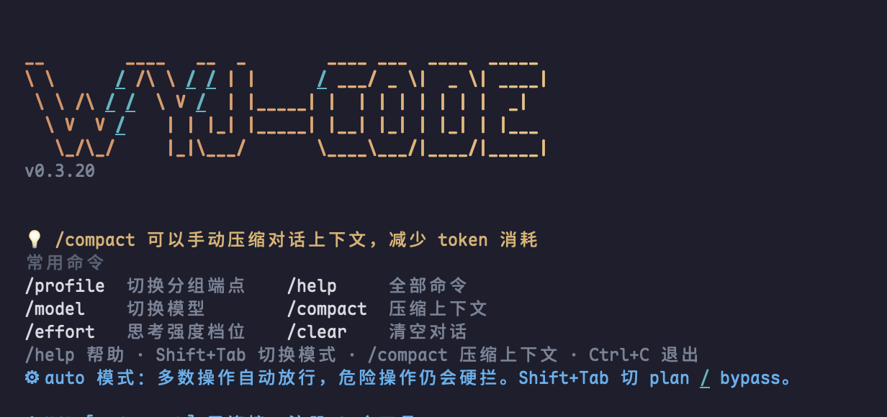

# wyj-code

[](https://github.com/wangyooujin/wyj-code/releases/latest)
[](https://www.rust-lang.org/)
[](#1-安装)
[](#开源协议)
[](https://wangyooujin.github.io/wyj-code/)
[](#测试与发版门禁)

**跑在你自己的终端里的 Rust AI 编程助手。单二进制、零遥测、1962 项测试。**



wyj-code 把 AI coding 的核心能力放进一个**可审计、可扩展、可本地运行**的终端工具：原生 TUI、
代码读写与命令执行、多 Agent 协作、MCP / Skill / Plugin 扩展、会话快照与隔离 worktree，
以及默认失败关闭的权限模型。同时支持 Anthropic Messages 与 OpenAI Chat Completions 双协议，
可连接 Claude、OpenAI、GLM、MiniMax、Kimi、DeepSeek、Qwen / 百炼、豆包 / 火山及其他兼容端点。

[项目主页](https://wangyooujin.github.io/wyj-code/) ·
[在线配置参考](https://wangyooujin.github.io/wyj-code/config.html) ·
[技术文档](https://wangyooujin.github.io/wyj-code/docs.html) ·
[GitHub Releases](https://github.com/wangyooujin/wyj-code/releases) ·
[更新日志](./CHANGELOG.md) ·
[贡献指南](./CONTRIBUTING.md)

---

## 为什么是它

| | |
|---|---|
| **单二进制发布** | release 无运行时依赖，`~10ms` 稳态冷启动。装完即用，不留服务进程。 |
| **每一步都看得见** | 工具调用逐条展开、写文件前弹确认、随时 ESC 打断。不必相信一段总结——过程本身就是记录。 |
| **11 个 crate / 1962 项测试** | 全量 `cargo test` 通过，`clippy -D warnings` 零告警，5 个平台产物同时发布。 |
| **零遥测** | 只有显式的模型请求、Web 工具与 MCP 调用会出网。配置 / 会话 / 记忆全在本机。 |
| **双协议 + 国内模型** | vendor 与线协议分离，一套工具链同时适配官方 API 与国内兼容端点。 |
| **默认失败关闭** | 受保护路径任何模式都不放行；无审批通道（headless / 子 Agent）时拒绝副作用操作。 |

---

## 60 秒上手

### 1. 安装

macOS / Linux：

```bash
curl -fsSL https://wangyooujin.github.io/wyj-code/install.sh | sh
```

Windows PowerShell：

```powershell
irm https://wangyooujin.github.io/wyj-code/install.ps1 | iex
```

脚本自动识别平台架构、拉取 GitHub 最新 Release、校验 SHA-256，装到用户目录
（`~/.local/bin/wyj-code` 或 `%USERPROFILE%\.wyj-code\bin\`），**无需 sudo / 管理员权限**。
之后用 `wyj-code update` 升级。

不想执行远程脚本？到 [Releases](https://github.com/wangyooujin/wyj-code/releases) 下载对应平台压缩包，
解压后运行包内 `install.sh` / `install.bat`。也可以从源码装：

```bash
git clone https://github.com/wangyooujin/wyj-code.git
cd wyj-code && ./build.sh install     # 需要 Rust 1.80+
```

### 2. 配一个 Key

推荐环境变量（优先级最高，且**永远不会被写回配置文件**，即使你在面板里保存过一次）：

```bash
export WYJ_CODE_API_KEY="sk-..."
```

想落盘又不写明文，就在 `~/.wyj-code/config.toml` 里用 `api_key_env = "MY_KEY_VAR"`
引用变量名。首次启动若没有 Key，TUI 会自动打开配置面板引导填写。

### 3. 跑起来

```bash
wyj-code                       # 交互式 TUI
wyj-code --cwd /path/to/proj   # 指定项目
wyj-code -c                    # 恢复上次会话
wyj-code --plan                # Plan 模式（只读工具 + 计划文档）
wyj-code -p "分析这个项目"       # 单次问答，不启动 TUI
wyj-code --headless            # Headless REPL
wyj-code run /review HEAD~1    # 一次性执行一条斜杠命令 / Skill
```

`wyj-code --config-status` 打印当前分组、模型与 Key 状态；TUI 内 `/doctor` 检查环境与扩展健康度。

---

## 核心特性

### 终端体验

- **ratatui 原生 TUI**：流式 Markdown、代码高亮、多行输入、图片粘贴、diff 预览。
- **折叠态优先**：每个工具调用只留标题行，`Ctrl+O` 随时展开全文；前台 Bash 输出按 100ms 节流实时推进，跑完即折叠。
- **应用内鼠标**：滚轮、拖选、双击选词、可拖动滚动条全部由应用实现，松开自动复制到系统剪贴板。
- **面板按显示宽度排版**：`/cost`、`/context` 中英文都对齐，子 Agent 用量单列成节。
- **终端不会被打坏**：进程级 panic hook 在崩溃时还原 alternate screen、鼠标捕获与 raw mode。

### 多模型与双协议

- **Anthropic Messages** 完整支持：thinking、cache_control、原生 `computer_20251124`、tool 内嵌图片回传。
- **OpenAI Chat Completions** 兼容：`reasoning_content`、`image_url`、tool_result 降级。
- **能力与协议分离**：`provider` 决定线协议，vendor 由 `base_url` + 模型名推断，
  `wyj-code model doctor` 报告每个能力是 `static_only` 还是已实测。
- **三条命令各管一件事**：`/profile` 管分组（写盘）、`/model` 只切模型（仅内存）、`/effort` 管思考档位（随会话落盘）。
- **思考档位协议无关**：Anthropic 发 `output_config.effort`，OpenAI 发顶层 `reasoning_effort`；
  端点不认的档位记成可见的 dropped，而不是发出去换一个 400。

### Agent 与工具

- 内置工具：Read / Write / Edit / Bash / Glob / Grep / WebFetch / WebSearch / TodoWrite /
  AskQuestion / SubAgent / Computer / AppComputer。
- **WebSearch 内置**：配一个 Key 就能用，无需 MCP、无需外挂脚本；后端可选 Tavily / Brave。
  详见下方[「内置网页搜索」](#内置网页搜索-websearch)。
- **Computer-use 读得懂屏幕**（macOS / Windows）：`list_elements` 可带 `include_text`
  返回每个文本节点的精确坐标，`read_text` 用系统 OCR 兜底自绘应用与图片里的字，
  `run_recipe` 提供编译期固定的 AppleScript 白名单（脚本正文永不来自模型）。
- **SubAgent 编排**：内置 general-purpose / Explore / Plan 三种类型，支持嵌套深度上限、并发上限、
  后台运行与落盘 trace；被 ESC 中断时仍交付「已经做到哪」的交接物。
- **上下文清理优先于摘要**：过期工具输出先外部化到 CAS（无损、可召回），清理不动了才跑压缩摘要。

### 工程化工作流

- **会话快照**：`checkpoint` / `rewind` / `branch`，可按 conversation / files / both 三种范围回滚。
  同一目录存在另一个实例时强制确认——它没有 checkpoint 可退。
- **隔离 worktree**：`workspace create/list/diff/accept/dispose`，两个 agent 并行改代码而不互踩。
- **Workflow DAG**：并行、token 预算、人工审批、pause / resume / retry / skip / cancel，
  有写权限的编码节点自动在独立 worktree 里跑。
- **ACP / daemon**：stdio adapter 与本地 TCP session registry，前端无关的事件协议。
- **可审计 Review**：`wyj-code review run --base HEAD^ --head HEAD --json` 产出机器可读证据。

### 安全与信任边界

- **三种模式**：`auto`（默认，本地确定性规则 → 模型分类器 → 逐次弹窗）、`plan`（只读 + 计划文档）、
  `bypass`（跳过询问，但**不免除禁令**）。`Shift+Tab` 循环切换。
- **任何模式都不放行**：`curl | bash`、`rm -rf ~`、`git push --force`、`git reset --hard`、
  `sudo <program>`、凭据路径、写入 `.git/` / `.env` / `*.pem` / `~/.wyj-code/`。
  这一层挂在权限策略入口，**不读任何授权状态**——授权只能免除问人，不能免除禁令。
- **凭据保护覆盖批量读取**：`Grep` / `Glob` / `CodeSearch` 有根校验 + 遍历过滤两层，
  一条 `Grep(pattern: "PRIVATE KEY", path: "~")` 读不到 `~/.ssh/id_rsa`。
- **项目级资源逐类批准**：`mcp.toml`（执行任意命令）、`skills/`（正文是指令）、
  `settings.json` 的 hooks 与 `verify.command`（被 `sh -c` 执行）三处都要显式信任，
  批准记录落在**仓库控制不到**的位置，内容变化后需重新批准。
  `wyj-code trust-mcp` / `trust-skills` / `trust-hooks`，或 `trust` 一次批三类。

### 本地优先与证据化

- 配置 / 会话 / 记忆 / 执行轨迹全在 `~/.wyj-code/`（可用 `WYJ_CODE_HOME` 整体重定向）；
  会话默认按项目分目录，`storage prune` 可按阈值回收，**默认不自动删历史**。
- **Memory v3**：Global / Project 两层作用域，淘汰按「写入新鲜度 × 0.30 + 使用强度 × 0.70」打分，
  跨会话还能检索原始 transcript。Global 候选走 Pending + 自然语言确认。
- **Evolution**：每个用户目标落盘为 Episode，生成带 scope / citation / TTL / 冲突检测的 Memory；
  Rule 与 Skill **永不自动激活**，必须经 `/evolve` 或 `wyj-code evolve approve` 显式批准。
- **编辑后自动验证**：项目声明 `verify.command` 后，每次 Edit / Write 成功框架立即跑一次，
  把退出码与截断后的输出回灌给模型自己修。
- **验收门禁**：声明 `acceptance.criteria` 后，「任务完成」由框架判定——不通过就不让回合结束，
  并把失败证据（文件与行号）回灌。

---

## 内置网页搜索 WebSearch

> **模型的知识有截止日期，你的代码库没有。**

它不是外挂脚本、不是 MCP server、也不是让模型自己拼 `curl`——而是和 Read / Grep / WebFetch
并列的一个正式内置工具。配一个搜索服务的 Key，模型立刻多出一双能看世界的眼睛。

```toml
# ~/.wyj-code/config.toml
[search]
provider = "tavily"          # 或 "brave"
api_key = "tvly-xxxxxxxx"    # 也可以走 WYJ_CODE_SEARCH_API_KEY，不落盘
max_results = 5              # 硬上限 10
```

重启后敲 `/doctor`，看到 `✓ 网页搜索 tavily` 就算好了。**没有插件要装、没有 server 要配。**

| 能力 | 说明 |
|---|---|
| **主题与时效** | `topic` 支持 general / news / finance，`time_range` 支持 day / week / month / year |
| **按域收敛** | `include_domains` / `exclude_domains` 限定官方文档与 issue tracker，屏蔽 SEO 农场 |
| **双后端** | Tavily 带问答式摘要，Brave 带 `safesearch` / `search_lang`，换后端只改一行 |
| **Key 只进请求头** | body 会被代理日志完整打印，头不会 |
| **搜索 → 深读接力** | 搜索给标题 + 链接 + 摘要，模型再用内置 WebFetch 读全文 |

两个刻意的设计：**没配 Key 就干脆不注册这个工具**（模型看不到一个注定失败的入口，不浪费一次往返）；
**provider 写错则显式报错**，绝不静默回退到默认后端。外部文本统一过 harness marker 转义，
网页正文里的 `</system-reminder>` 伪造不了对话结构。

---

## 配置

全局配置只有一个文件：`~/.wyj-code/config.toml`。日常最常改的几项：

```toml
provider = "anthropic"       # 或 "openai"
model = "claude-opus-4-8"
base_url = ""                # 留空用供应商默认端点
max_tokens = 32000
context_window = 200000      # 必须填真实值，压缩与清理阈值都由它推算
vision = true
log_level = "warn"
language = ""                # "en"/"zh"，留空自动检测；同时决定模型输出语言
```

项目级配置在 `<git-root>/.wyj-code/`（可提交、随 clone 落地）：
`settings.toml`（按名禁用 skill / MCP）、`settings.json`（hooks / verify / acceptance）、
`mcp.toml`、`skills/`、`agents/`。**项目文件不能覆盖全局模型凭据，也不能静默扩大权限。**

完整字段说明（21 个 profile 字段、`[search]` / `[subagent]` / `[agent]` / `[ui]` /
`[context_edit]` / `[storage]` / `[persist_cap]` / `[auto_mode]` / `[notify]` /
`[evolution]` / `[routing]` / `[model_runtime]` / `[computer_use]` / `[[mcp_servers]]`
全字段 + 15 个环境变量）：

- **在线版（推荐）**：<https://wangyooujin.github.io/wyj-code/config.html>
- **仓库版**：[`docs/reference/config.md`](./docs/reference/config.md)

---

## 项目资源

| 路径 | 内容 |
|---|---|
| `~/.wyj-code/config.toml` | 全局 Profile、模型、语言与运行时配置 |
| `~/.wyj-code/sessions/<project_key>/` | 本地会话、checkpoint 与子 Agent trace |
| `~/.wyj-code/cas/` | 内容寻址 Blob 池（上下文清理与会话快照共用） |
| `~/.wyj-code/memory-v3/`、`evolution/` | 跨会话记忆与自进化数据 |
| `~/.wyj-code/projects/<project_key>/` | 项目级授权名单与三类信任批准记录 |
| `<repo>/.wyj-code/` | 项目级 settings / MCP / Skill / Agent 资源 |

治理入口：

```bash
wyj-code storage {status,doctor,prune,migrate}      # 存储占用诊断、清理与迁移
wyj-code extensions {list,doctor,install,upgrade}   # Skill / MCP / Plugin 治理
wyj-code evolve {status,list,approve,reject,doctor} # Memory / Rule / Skill 候选治理
wyj-code memory {status,search,search-sessions}     # Memory v3 查询与原文回溯
wyj-code model doctor [--probe full]                # 模型身份、协议与能力来源
wyj-code workspace {create,list,diff,accept}        # 隔离 Git worktree
wyj-code workflow {validate,run,status,control}     # 多 Agent DAG
wyj-code session {checkpoint,checkpoints,rewind,branch}
wyj-code review run --base HEAD^ --head HEAD --json
```

TUI 内输入 `/help` 查看全部斜杠命令。

---

## 架构

单一 `wyj-code` 二进制，11 个 crate 分四层：

| Crate | 名称 | 职责 |
|---|---|---|
| `crates/cli` | 二进制入口 | 组装全部 crate、解析 CLI 参数，启动 TUI / REPL / ACP / daemon / Workflow |
| `crates/tui` | `wyj-tui` | ratatui 渲染：消息流、输入框、权限确认、面板、鼠标与选区 |
| `crates/tools` | `wyj-tools` | 工具实现（Read/Write/Edit/Bash/Grep/WebSearch/SubAgent/Computer…） |
| `crates/computer` | `wyj-computer` | computer-use 系统层：截图、输入合成、坐标缩放数学 |
| `crates/commands` | `wyj-commands` | Slash 命令注册表与内置命令 |
| `crates/mcp` | `wyj-mcp` | MCP 客户端桥接（stdio / streamable http） |
| `crates/store` | `wyj-store` | 扩展安装与 lockfile、Plugin runtime、信任门控、SkillHub |
| `crates/i18n` | `wyj-i18n` | 多语言资源与运行时语言切换 |
| `crates/core` | `wyj-core` | Agent 循环、会话、权限、checkpoint、上下文管理、workspace/workflow |
| `crates/api` | `wyj-api` | LLM Provider 抽象 + 双协议实现 + SSE 解析与断流看门狗 |
| `crates/config` | `wyj-config` | 配置加载、落盘布局、项目级 MCP/设置、跨进程文件锁 |

更细的实现细节与「为什么这样设计」的背景在 [`doc/architecture.md`](./doc/architecture.md)
与 [`CLAUDE.md`](./CLAUDE.md)——后者是本仓库的开发规约，同时喂给编码助手作为项目上下文。

> **注意**：wyj-code 自己读取的项目记忆文件是 **`AGENTS.md`**（全局 `~/.wyj-code/AGENTS.md`
> + 仓库根到 cwd 的祖先链），回退顺序 `AGENTS.md` → `CLAUDE.md` → `GEMINI.md` → `AGENT.md`，
> 个人覆盖槽 `AGENTS.local.md` → `CLAUDE.local.md`。**wyj-code 不读取任何 `~/.claude/` 路径。**

---

## 测试与发版门禁

```bash
cargo fmt --all -- --check
cargo clippy --workspace --all-targets --locked -- -D warnings
cargo test --workspace --locked     # 1962 项
cargo build --release
```

改了 harness（提示词 / 工具描述 / 可见性 / 压缩策略 / 验收门禁）必须跑评测基线：

```bash
benchmarks/verify-tasks.sh          # 任务集自检，零 API 费用
benchmarks/run.sh --repeat 3        # 20 个任务 × 3 次
benchmarks/compare.sh <baseline> <candidate>
```

纪律：一次只改一个组件、每组 ≥3 次重复、至少 2 个模型对照。详见 [`benchmarks/README.md`](./benchmarks/README.md)。

---

## 安全与隐私

- **无隐式遥测**：只有显式模型请求、Web 工具或 MCP 调用会访问网络，无崩溃上报。
- **API Key**：优先环境变量；配置诊断只显示掩码；写盘后自动 `chmod 0600`。
- **搜索 Key 只进请求头**，绝不放进请求体。
- **`--bypass-permissions`**：只跳过普通交互确认，**不**覆盖 `hard_deny`、受保护路径与凭据目录。
- **无 UI 时默认拒绝**：headless、子 Agent、`-p` 没有审批通道时不会自动批准副作用操作。
- **Checkpoint 的边界**：只能恢复会话与文件，**不**能撤销网络请求、数据库写入或已发出的消息。

发现安全问题请**不要**在 Issue 里附带真实凭据、私有 endpoint 或敏感日志，
先提交经过脱敏的报告到 [GitHub Issues](https://github.com/wangyooujin/wyj-code/issues)。

---

## 文档与社区

| 内容 | 路径 |
|---|---|
| 项目主页 | <https://wangyooujin.github.io/wyj-code/> |
| **在线配置参考** | <https://wangyooujin.github.io/wyj-code/config.html> |
| 技术文档（架构 / 能力 / 安全模型） | <https://wangyooujin.github.io/wyj-code/docs.html> |
| 仓库更新日志 | [`CHANGELOG.md`](./CHANGELOG.md) |
| 架构详细文档 | [`doc/architecture.md`](./doc/architecture.md) |
| 配置全量参考（Markdown） | [`docs/reference/config.md`](./docs/reference/config.md) |
| 国产模型适配报告 | [`doc/analysis/domestic-models-vs-claude-code.md`](./doc/analysis/domestic-models-vs-claude-code.md) |
| 版本规划 | [`doc/plan/`](./doc/plan/) |
| 开发约束与架构细节 | [`CLAUDE.md`](./CLAUDE.md) |
| 贡献指南 | [`CONTRIBUTING.md`](./CONTRIBUTING.md) |

---

## 开源协议

**MIT OR Apache-2.0** 双重许可，任选其一：

- [`LICENSE-MIT`](./LICENSE-MIT)
- [`LICENSE-APACHE`](./LICENSE-APACHE)

基于公开的 Anthropic Messages API、OpenAI Chat Completions API 与 MCP 规范独立实现，
不含第三方专有 prompt 或品牌资产，与 Anthropic / OpenAI 官方产品无关联。
